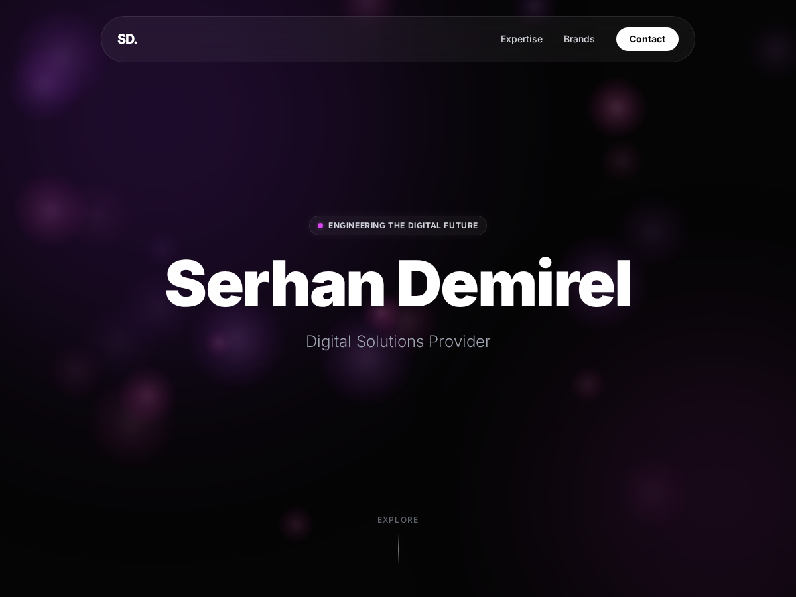
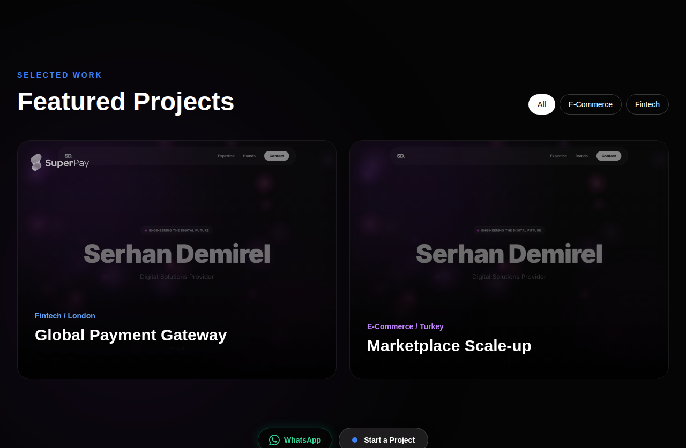
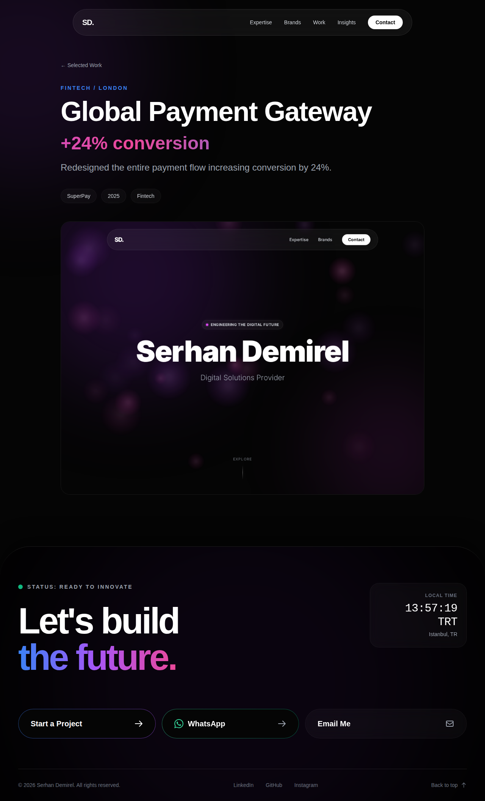
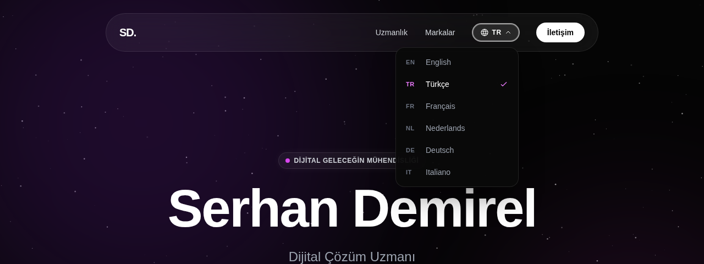
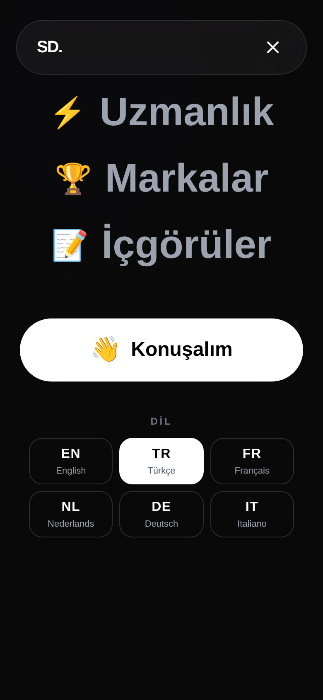
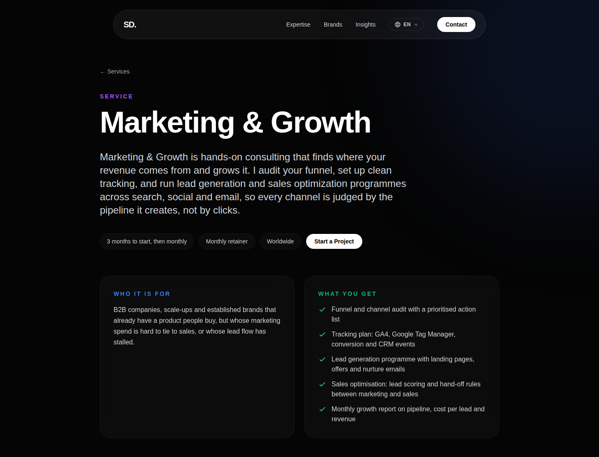
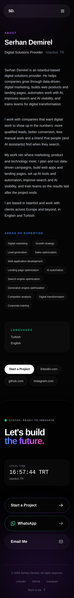

# serhandemirel.com for WordPress

The WordPress theme for [serhandemirel.com](https://serhandemirel.com). The original one-page site lives in [serhanco/serhandemirel.comLP](https://github.com/serhanco/serhandemirel.comLP).

The folders mirror a WordPress install, so the theme can be copied (or zipped and uploaded) straight into `wp-content/themes/`:

| Folder | What it is |
| --- | --- |
| [`wp-content/themes/serhandemirel`](wp-content/themes/serhandemirel) | The theme, with everything built in: templates, settings panel, tracking, projects, services, expertise, brands, messages, profile, structured data, llms.txt and the contact form ([README](wp-content/themes/serhandemirel/README.md)) |
| [`scripts/`](scripts) | Local WordPress Playground setup |
| [`docs/content-model.md`](docs/content-model.md) | Content types and fields: what exists and what is planned (Turkish) |
| [`docs/go-live.md`](docs/go-live.md) | Step-by-step checklist for the live server: Polylang, profile, services, search engines, mail (Turkish) |
| [`docs/screenshots/`](docs/screenshots) | Screenshots of the theme |

No plugin is needed. Activating the theme imports the expertise cards, brand logos, service-page drafts and an About draft. [Polylang](https://wordpress.org/plugins/polylang/) is optional: without it the site runs in the language set under Settings → General; with it, in six languages.

Sites that used the earlier **Serhan Demirel Core** plugin: update the theme, then deactivate and delete the plugin. Content, settings and messages are stored the same way, so nothing moves.

## Run it locally

```
./scripts/start.sh
```

This starts WordPress Playground at http://127.0.0.1:9400 with the theme mounted from this repo, installs Polylang, activates the theme, sets the site title and runs the language setup (`scripts/blueprint.json`). Log in at http://127.0.0.1:9400/wp-login.php with `admin` / `password`. Playground keeps nothing between restarts. Needs Node 20 or newer.

## Screenshots



| Selected Work | Project page |
| --- | --- |
|  |  |

| Language switcher (desktop) | Language switcher (mobile) |
| --- | --- |
|  |  |

| Service page | About (mobile) |
| --- | --- |
|  |  |
